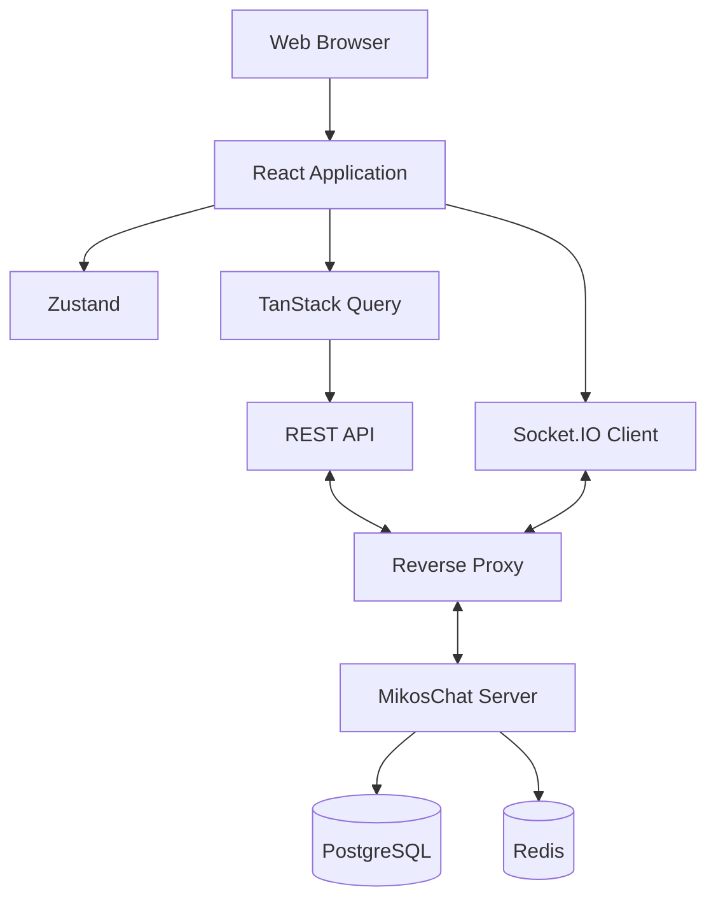

<div align="center">


# MikosChat Web

**Connect freely. Communicate your way.**

A modern, open-source messaging experience — directly in your browser.

[](LICENSE)
[](https://react.dev)
[](https://typescriptlang.org)
[](#project-status)

[](https://github.com/Matisiowy/MikosChat-Web/actions)
[](https://github.com/Matisiowy/MikosChat-Web/stargazers)
[](https://github.com/Matisiowy/MikosChat-Web/issues)

[**Launch MikosChat**](https://chat.mikrusmusic.pl) |
[Desktop](https://github.com/Matisiowy/MikosChat-Desktop) |
[Server](https://github.com/Matisiowy/MikosChat-Server) |
[Report a bug](https://github.com/Matisiowy/MikosChat-Web/issues)

</div>

---

## About

MikosChat Web is the official browser-based client for the MikosChat messaging platform.

Designed around real-time communication, a modern dark interface and self-hosted infrastructure, it brings conversations, friends and shared media together in one application.

No desktop installation is required.

## Features

### Messaging

- Direct and group conversations
- Instant message delivery
- Message editing, deletion and replies
- Emoji reactions
- Delivery and read receipts
- Conversation message search
- Images, videos, audio and file attachments

### Social

- Friend requests and friend management
- User search and discovery
- Online presence
- Typing indicators
- User profiles and avatars
- User blocking
- Group administration and customization

### Experience

- Responsive dark interface
- Persistent browser sessions
- Conversation muting
- Real-time synchronization
- Authenticated media downloads
- Service status interface

## Technology stack

<div align="center">


</div>

| Technology | Purpose |
| :--- | :--- |
| React | Component-based interface |
| TypeScript | Type-safe application development |
| Vite | Development server and production bundling |
| Tailwind CSS | Responsive styling |
| Zustand | Client-side state |
| TanStack Query | Server state and caching |
| Socket.IO | Real-time communication |
| Axios | HTTP API integration |
| Nginx | Containerized web delivery |

## Architecture



## Getting started

### Requirements

- Node.js 24
- npm
- A running MikosChat Server instance

### Local development

```bash
git clone https://github.com/Matisiowy/MikosChat-Web.git
cd MikosChat-Web

npm ci
cp .env.example .env
```

Configure `API_PROXY_TARGET` in `.env` to point to your backend.

```bash
npm run dev
```

Open [http://localhost:5173](http://localhost:5173).

## Production build

```bash
npm ci
npm run build
```

Production assets are generated in `dist/`.

Configure your reverse proxy to serve the SPA and forward `/api/v1` and `/socket.io` requests to MikosChat Server.

The backend must permit the deployed web origin for both CORS and browser authentication.

## Docker

A Dockerfile and Nginx configuration are included.

```bash
docker build -t mikoschat-web .
```

For an integrated backend and frontend deployment, see the Docker Compose files in [MikosChat Server](https://github.com/Matisiowy/MikosChat-Server).

## Project structure

```text
MikosChat-Web/
├── .github/          CI and repository automation
├── public/           Static assets
├── src/
│   ├── api/          REST and WebSocket clients
│   ├── components/   Reusable UI components
│   ├── hooks/        Application logic
│   ├── pages/        Application views
│   ├── stores/       Client state
│   ├── types/        TypeScript definitions
│   └── utils/        Shared utilities
├── Dockerfile
├── nginx.conf
└── package.json
```

## Authentication and security

The web client uses short-lived access tokens and HttpOnly refresh cookies.

Browser sessions support refresh token rotation, optional persistence and coordinated session operations.

Production deployments should use HTTPS and explicitly configured trusted origins.

End-to-end message encryption is not yet available.

See [SECURITY.md](SECURITY.md) for security reporting.

## Roadmap

- [x] Real-time messaging
- [x] Direct and group conversations
- [x] User management and social features
- [x] Media attachments
- [x] Conversation search
- [x] Persistent browser authentication
- [x] Docker support
- [ ] Voice calls
- [ ] Video calls
- [ ] Screen sharing
- [ ] End-to-end encryption
- [ ] Accessibility and performance improvements

## Ecosystem

| Repository | Description |
| :--- | :--- |
| [MikosChat Web](https://github.com/Matisiowy/MikosChat-Web) | Browser-based messaging client |
| [MikosChat Desktop](https://github.com/Matisiowy/MikosChat-Desktop) | Native desktop experience |
| [MikosChat Server](https://github.com/Matisiowy/MikosChat-Server) | Messaging backend |

## Contributing

We welcome contributions, bug reports and suggestions.

Please read [CONTRIBUTING.md](CONTRIBUTING.md) before submitting a pull request.

## Project status

> [!NOTE]
> MikosChat is currently in alpha and under active development. Features, APIs and deployment requirements may change.

## License

Licensed under the [GNU Affero General Public License v3.0](LICENSE).

---

<div align="center">

**MikosChat**

Open communication. Independent infrastructure.

Developed by [Matisiowy](https://github.com/Matisiowy)

Copyright © 2026 MikosChat contributors.

</div>
